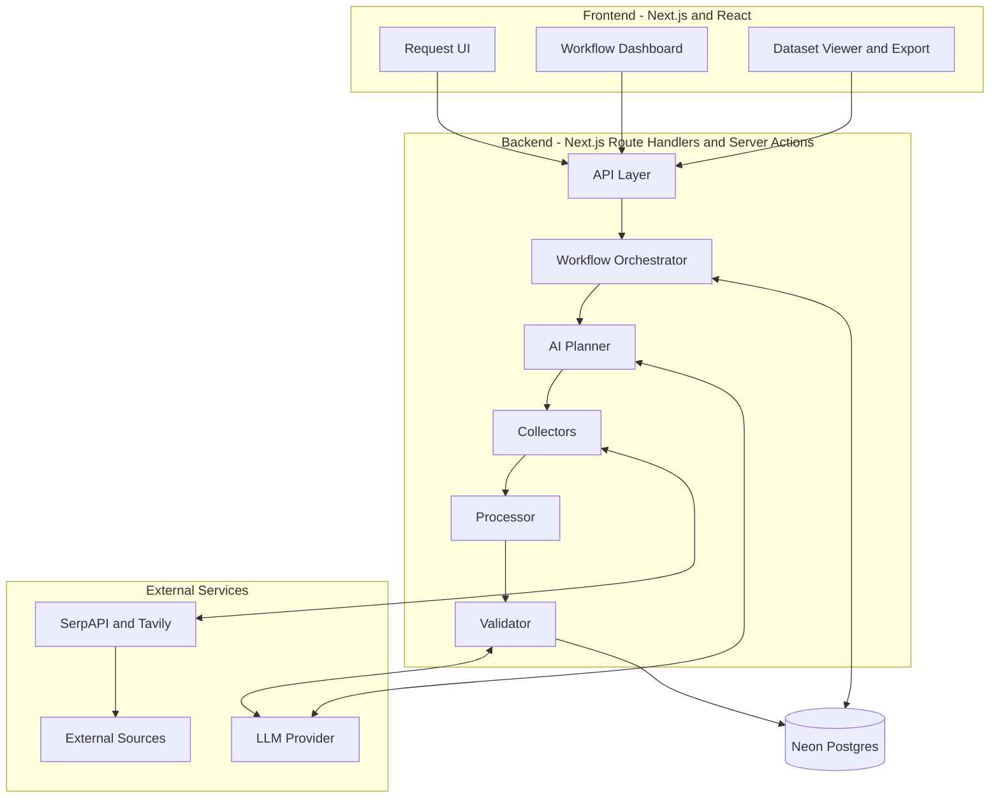

<div align="center">

# 🔎 FetchIT

### From Natural Language input to Structured, Actionable Data.

**An AI-powered data intelligence platform that automates multi-source collection, processing, validation, and workflow management, so you never hand-scrape or hand-clean data again.**


</div>

---

## 📌 Table of Contents

- [The Problem](#-the-problem)
- [The Solution](#-the-solution)
- [Key Features](#-key-features)
- [Tech Stack](#-tech-stack)
- [Workflow](#-workflow)
- [System Architecture](#-system-architecture)
- [Folder Structure](#-folder-structure)
- [Environment Setup](#-environment-setup)
- [Contributing](#-contributing)
- [Author](#-author)

---

## 🚨 The Problem

Data is the fuel for research, analytics, journalism, and AI, but **getting good data is painfully manual**:

- 🕸️ **Scattered sources**: the data you need lives across websites, portals, APIs, and documents.
- 🧹 **Messy and inconsistent**: duplicates, missing values, mixed formats, and conflicting records.
- ❓ **No trust signal**: you rarely know *where* a number came from or whether it is correct.
- ⏳ **Slow, repetitive workflows**: collecting, cleaning, and verifying the same kinds of data again and again.
- 🧑‍💻 **High technical barrier**: non-technical users cannot write scrapers or pipelines.

The result: hours of effort, unreliable datasets, and decisions built on shaky foundations.

---

## 💡 The Solution

**FetchIT** turns a simple natural-language request into a finished dataset.

> *"Give me the top 50 AI startups in India with funding, founding year, and website."*

FetchIT then **understands the request → plans the sources → collects from multiple places → cleans and normalizes → validates → attaches sources → delivers a dataset you can trust.**

Every record is traceable back to its origin, and every run is tracked as a managed workflow, so results are **reproducible, auditable, and ready to use**.

---

## ✨ Key Features

- **Natural-Language Data Requests**: Express data requirements in everyday language without needing complex queries or manual workflows.
- **Multilingual & Multimodal Input**: Work with supported languages, text, images, voice, and video.
- **Personalized Intelligence**: Adapt results to user interests, purpose, and preferred output format.
- **Data Processing & Validation**: Structure, clean, normalize, and validate information for better usability.
- **Source-Aware Results**: Preserve source references where available to support traceability.
- **Persistent Workspaces**: Organize work through collections, query history, and saved documents.
- **Charts & Insights**: Turn structured data into visual summaries that make patterns easier to understand.
- **Exportable Results**: Move processed data into downstream workflows using supported export formats.

---

## 🧰 Tech Stack

| Layer | Technology |
| --- | --- |
| **Framework** | [Next.js](https://nextjs.org) (App Router) |
| **Language** | TypeScript |
| **UI** | Tailwind CSS, shadcn/ui components |
| **Database** | [Neon](https://neon.tech) serverless Postgres, with SQL migrations |
| **AI / LLM** | LLM-powered request understanding, extraction, and validation |
| **Search & Data Collection** | [SerpAPI](https://serpapi.com) and [Tavily](https://tavily.com) for live multi-source web search and retrieval |
| **Package Manager** | pnpm |
| **Prototyping & Deploy** | [v0](https://v0.app), with auto-deploy on merge to `main` |

---

## 🔄 Workflow


1. **Request**: the user describes the dataset they need.
2. **Understand & Plan**: the AI infers the entities, fields, and filters, and drafts a target schema.
3. **Discover Sources**: the best candidate sources are identified for the request using live web search (SerpAPI and Tavily).
4. **Collect**: data is fetched from multiple sources in an automated job.
5. **Process**: records are cleaned, deduplicated, and normalized to one schema.
6. **Validate**: values are cross-checked across sources; conflicts and low-confidence rows are flagged.
7. **Attribute**: each field is linked to the source it came from.
8. **Deliver**: the finished dataset is stored, reviewable, and exportable.

---

## 🧩 System Architecture



**Design principles**

- **Modular pipeline**: planning, collection, processing, and validation are separate stages that can evolve independently.
- **Provenance-first**: source metadata travels with the data from collection through to export.
- **Workflow-centric**: every request becomes a tracked job with state, history, and results.
- **Serverless-ready**: Next.js and Neon scale on demand with zero server management.

---

## 📁 Folder Structure

```
FetchIT/
├── app/                  # Next.js App Router: pages, layouts, API routes
├── components/           # Reusable UI components (shadcn/ui based)
├── lib/                  # Core logic: pipeline stages, helpers, utilities
├── migrations/           # SQL migrations for the Neon Postgres schema
├── scripts/              # Utility and maintenance scripts
├── public/               # Static assets
├── .agents/skills/       # AI agent skills / tooling configuration
├── neon.ts               # Neon database connection setup
├── components.json       # shadcn/ui configuration
├── next.config.mjs       # Next.js configuration
├── postcss.config.mjs    # PostCSS / Tailwind configuration
├── tsconfig.json         # TypeScript configuration
├── pnpm-workspace.yaml   # pnpm workspace configuration
├── package.json          # Dependencies and scripts
├── AGENTS.md / CLAUDE.md # Guidance files for AI coding agents
└── README.md             # You are here
```

---

## 🔧 Environment Setup

### Prerequisites

- Node.js
- pnpm
- A Neon PostgreSQL database
- Required AI API credentials
- SerpAPI and Tavily API keys

### Configuration

Create a `.env.local` file in the project root:

```env
DATABASE_URL=your_neon_database_url
AI_API_KEY=your_ai_api_key
SERPAPI_API_KEY=your_serpapi_key
TAVILY_API_KEY=your_tavily_key
```

Keep credentials private and never commit secrets to version control.

### Run Locally

```bash
git clone https://github.com/ishita2740/FetchIT.git
cd FetchIT
pnpm install
pnpm dev
```

Open `http://localhost:3000` to access the application.

---

## 🤝 Contributing

Contributions, ideas, and feedback are welcome!

1. Fork the repo
2. Create a feature branch: `git checkout -b feature/amazing-idea`
3. Commit your changes: `git commit -m "Add amazing idea"`
4. Push the branch: `git push origin feature/amazing-idea`
5. Open a Pull Request

---

## 👤 Author

**Ishita**
GitHub: [@ishita2740](https://github.com/ishita2740)

---

<div align="center">

⭐ **If FetchIT helped you, give it a star!** ⭐

*Built with Next.js, Neon, and a lot of curiosity.*

</div>
